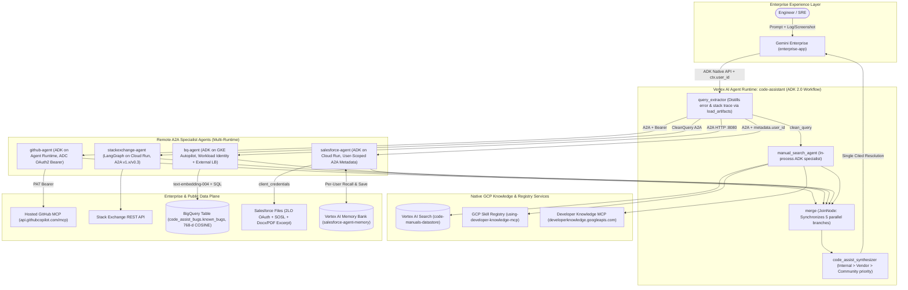
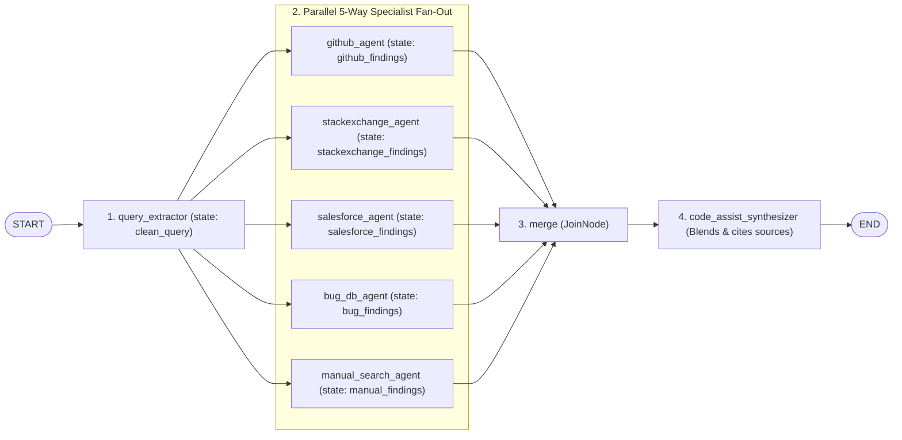
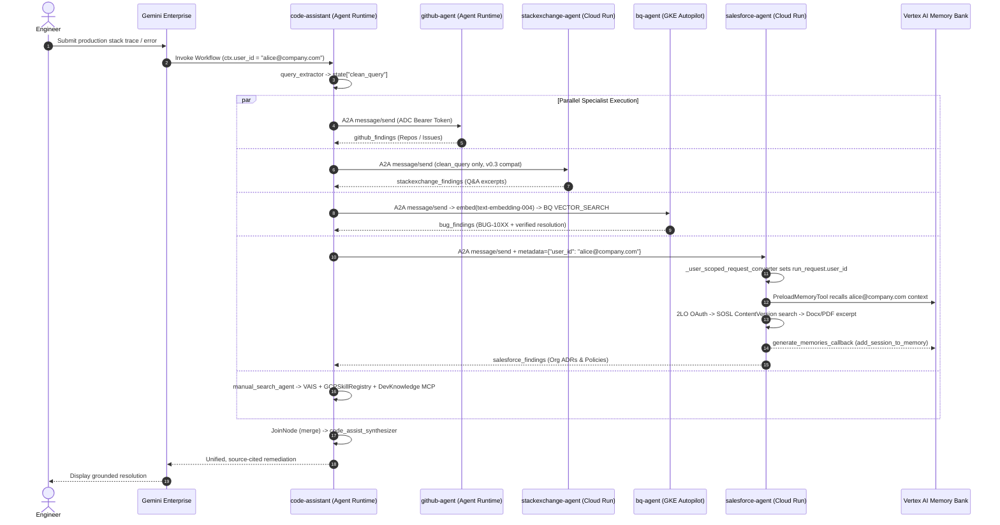
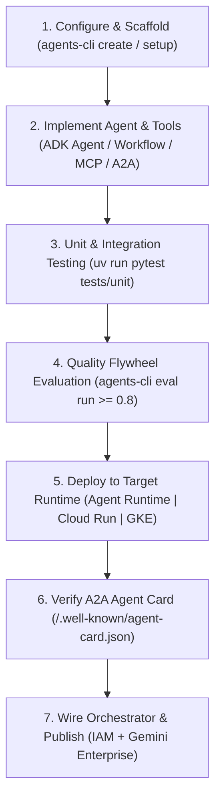

# Step-by-Step Lab Runbook: Build Enterprise Agents ("Code Assist")

This runbook provides an end-to-end operational guide, architectural blueprints, execution workflows, reference implementations, deployment commands, and troubleshooting playbooks for the **FDE: Build Enterprise Agents** challenge lab on Google Cloud.

---

## Table of Contents

1. [Lab Objective & Business Scenario](#1-lab-objective--business-scenario)
2. [Enterprise System Architecture](#2-enterprise-system-architecture)
3. [End-to-End Workflows](#3-end-to-end-workflows)
   - [3.1 ADK 2.0 Parallel Fan-Out & Join Workflow](#31-adk-20-parallel-fan-out--join-workflow)
   - [3.2 Cross-Runtime Request & User-Identity Sequence](#32-cross-runtime-request--user-identity-sequence)
   - [3.3 Agent Engineering & Deployment Lifecycle](#33-agent-engineering--deployment-lifecycle)
4. [Task 1: Environment Bootstrap & Vertex AI Search Datastore](#4-task-1-environment-bootstrap--vertex-ai-search-datastore)
5. [Task 2: GitHub Specialist Agent (`github-agent`) on Agent Runtime](#5-task-2-github-specialist-agent-github-agent-on-agent-runtime)
6. [Task 3: Stack Exchange Specialist Agent (`stackexchange-agent`) with LangGraph](#6-task-3-stack-exchange-specialist-agent-stackexchange-agent-with-langgraph)
7. [Task 4: BigQuery Bug Database Specialist (`bq-agent`) on GKE Autopilot](#7-task-4-bigquery-bug-database-specialist-bq-agent-on-gke-autopilot)
8. [Task 5: Root Orchestrator (`code-assistant`), Skill Registry & Developer Knowledge MCP](#8-task-5-root-orchestrator-code-assistant-skill-registry--developer-knowledge-mcp)
9. [Task 6: Publishing `code-assistant` to Gemini Enterprise](#9-task-6-publishing-code-assistant-to-gemini-enterprise)
10. [Task 7: Salesforce Specialist (`salesforce-agent`) with 2LO OAuth & Vertex AI Memory Bank](#10-task-7-salesforce-specialist-salesforce-agent-with-2lo-oauth--vertex-ai-memory-bank)
11. [Task 8: End-to-End Verification & Testing](#11-task-8-end-to-end-verification--testing)
12. [Production Troubleshooting Matrix](#12-production-troubleshooting-matrix)

---

## 1. Lab Objective & Business Scenario

Engineering teams lose critical incident-response time hunting across siloed systems when a production error occurs:
- **BigQuery (`code_assist_bugs.known_bugs`)**: Historical production incidents and verified fixes.
- **Engineering Handbook (`Vertex AI Search`)**: Team runbooks, coding standards, and internal guides.
- **Official Google Developer Docs (`Developer Knowledge MCP`)**: Authoritative Cloud, ADK, Firebase, and Go documentation.
- **Salesforce Files (`SOSL REST API`)**: Cross-team Architecture Decision Records (ADRs) and org-wide security/timeout policies.
- **GitHub (`GitHub Copilot MCP`) & Stack Exchange (`LangGraph`)**: Open-source repository issues, PRs, and community Q&A.

In this lab, you build, evaluate, secure, and deploy **Code Assist** — a distributed multi-agent system spanning **Vertex AI Agent Runtime**, **Cloud Run**, and **GKE Autopilot**, communicating over the open **Agent2Agent (A2A)** protocol and surfaced to end users in **Gemini Enterprise**.

---

## 2. Enterprise System Architecture



---

## 3. End-to-End Workflows

### 3.1 ADK 2.0 Parallel Fan-Out & Join Workflow

Unlike conversational LLM routers that call sub-agents sequentially (incurring $O(N)$ serial latency), `code-assistant` uses an **ADK 2.0 deterministic graph `Workflow`** with parallel fan-out and a synchronization `JoinNode`:



### 3.2 Cross-Runtime Request & User-Identity Sequence

A key architectural challenge in multi-agent systems is preserving **end-user identity** across A2A hops so downstream specialists scope long-term memory to the human engineer rather than an ephemeral conversation ID (`A2A_USER_{context_id}`).



### 3.3 Agent Engineering & Deployment Lifecycle



---

## 4. Task 1: Environment Bootstrap & Vertex AI Search Datastore

### Step 1.1: Authenticate & Set Project Variables

```bash
export PROJECT_ID="YOUR_GCP_PROJECT_ID"
export REGION="us-central1"

gcloud auth login
gcloud auth application-default login
gcloud config set project "${PROJECT_ID}"
```

### Step 1.2: Download Lab Assets & Install Tooling (`agents-cli` + `terraform`)

```bash
cd ~
gcloud storage cp -r "gs://${PROJECT_ID}-bucket/agents" .
mkdir -p ~/.vscode
gcloud storage cp "gs://${PROJECT_ID}-bucket/settings.json" ~/.vscode/

export PATH="${HOME}/.local/bin:${PATH}"
uv tool install google-agents-cli
agents-cli info
agents-cli setup --agent all

# Install HashiCorp Terraform (used for GKE Autopilot provisioning in Task 4)
wget -O - https://apt.releases.hashicorp.com/gpg | \
  sudo gpg --dearmor -o /usr/share/keyrings/hashicorp-archive-keyring.gpg
echo "deb [arch=$(dpkg --print-architecture) signed-by=/usr/share/keyrings/hashicorp-archive-keyring.gpg] https://apt.releases.hashicorp.com $(grep -oP '(?<=UBUNTU_CODENAME=).*' /etc/os-release || lsb_release -cs) main" | \
  sudo tee /etc/apt/sources.list.d/hashicorp.list
sudo apt-get update && sudo apt-get install -y terraform
terraform -version
```

### Step 1.3: Create & Populate the Vertex AI Search Engineering Handbook Datastore

Create the `code-manuals-datastore` Discovery Engine Data Store and import the team's engineering handbook documents from Cloud Storage:

```bash
# 1. Create the unstructured content data store
curl -X POST \
  -H "Authorization: Bearer $(gcloud auth print-access-token)" \
  -H "Content-Type: application/json" \
  -H "X-Goog-User-Project: ${PROJECT_ID}" \
  "https://discoveryengine.googleapis.com/v1/projects/${PROJECT_ID}/locations/global/collections/default_collection/dataStores?dataStoreId=code-manuals-datastore" \
  -d '{
    "displayName": "Code manuals",
    "industryVertical": "GENERIC",
    "solutionTypes": ["SOLUTION_TYPE_SEARCH"],
    "contentConfig": "CONTENT_REQUIRED"
  }'

# 2. Import handbook documents from GCS
curl -X POST \
  -H "Authorization: Bearer $(gcloud auth print-access-token)" \
  -H "Content-Type: application/json" \
  "https://discoveryengine.googleapis.com/v1/projects/${PROJECT_ID}/locations/global/collections/default_collection/dataStores/code-manuals-datastore/branches/0/documents:import" \
  -d '{
    "reconciliationMode": "INCREMENTAL",
    "gcsSource": {
      "inputUris": ["gs://'"${PROJECT_ID}"'-bucket/code_manuals/*"],
      "dataSchema": "content"
    }
  }'
```

---

## 5. Task 2: GitHub Specialist Agent (`github-agent`) on Agent Runtime

`github-agent` connects to GitHub's hosted MCP server (`https://api.githubcopilot.com/mcp/`) via ADK's `McpToolset`, restricting tool exposure strictly to read-only operations (`search_repositories`, `search_issues`, `list_issues`).

### Step 2.1: Implement `McpToolset` in `agents/github-agent/app/agent.py`

Ensure `github_mcp_toolset` is wired with Bearer PAT authentication and `GITHUB_TOOL_FILTER`:

```python
GITHUB_TOOL_FILTER = ["search_repositories", "search_issues", "list_issues"]

github_mcp_toolset = McpToolset(
    connection_params=StreamableHTTPConnectionParams(
        url=GITHUB_MCP_URL,
        headers={"Authorization": f"Bearer {GITHUB_TOKEN}"},
    ),
    tool_filter=GITHUB_TOOL_FILTER,
)
```

### Step 2.2: Configure `.env` & Run Unit Tests

> [!IMPORTANT]
> Never commit `.env` or Personal Access Tokens to Git. Use a read-only GitHub PAT (`public_repo` or `Contents/Issues/Metadata: Read-only`).

```bash
cd ~/agents/github-agent

cat << EOF > .env
GOOGLE_CLOUD_PROJECT=${PROJECT_ID}
GOOGLE_CLOUD_LOCATION=global
GOOGLE_GENAI_USE_VERTEXAI=True
MODEL=gemini-3.5-flash
GITHUB_PERSONAL_ACCESS_TOKEN=YOUR_GITHUB_READONLY_PAT
GITHUB_MCP_URL=https://api.githubcopilot.com/mcp/
EOF

agents-cli install
uv run pytest tests/unit
```

### Step 2.3: Deploy to Vertex AI Agent Runtime & Verify A2A Endpoint

```bash
cd ~/agents/github-agent

agents-cli deploy \
  --project "${PROJECT_ID}" \
  --no-confirm-project \
  --no-wait \
  --update-env-vars "$(grep -v '^#' .env | grep -v '^$' | grep -v '^GOOGLE_CLOUD_PROJECT' | paste -sd,)"

# Monitor deployment until SUCCEEDED (~5-8 minutes)
agents-cli deploy --status
```

Once deployed, export the Agent Card URL printed by `agents-cli deploy --status` and test both the Agent Card and live queries:

```bash
export GITHUB_AGENT_URL="https://us-central1-aiplatform.googleapis.com/reasoningEngines/v1/projects/<PROJECT_NUMBER>/locations/us-central1/reasoningEngines/<ENGINE_ID>/api/a2a/app/.well-known/agent-card.json"
echo "export GITHUB_AGENT_URL='${GITHUB_AGENT_URL}'" >> ~/.bashrc

# Verify authenticated A2A card (Agent Runtime requires an OAuth2 Bearer token)
curl -sS -H "Authorization: Bearer $(gcloud auth print-access-token)" \
  "${GITHUB_AGENT_URL}" | python3 -m json.tool

# Smoke-test via agents-cli
export GITHUB_ENGINE_URL=$(echo "${GITHUB_AGENT_URL}" | sed -E 's#/reasoningEngines/v1/#/v1/#; s#/api/.*##')
agents-cli run --url "${GITHUB_ENGINE_URL}" --mode a2a "Find the google/adk-python repository"
```

---

## 6. Task 3: Stack Exchange Specialist Agent (`stackexchange-agent`) with LangGraph

`stackexchange-agent` demonstrates **cross-framework A2A interoperability**: it is a zero-LLM **LangGraph** state machine (`START -> search -> END`) wrapped with `a2a-sdk` 1.x and `enable_v0_3_compat=True` so ADK's `RemoteA2aAgent` can consume it seamlessly.

### Step 3.1: Implement the LangGraph Workflow in `agents/stackexchange-agent/app/agent.py`

```python
graph = (
    StateGraph(State)
    .add_node("search", search)
    .add_edge(START, "search")
    .add_edge("search", END)
    .compile()
)
```

Verify unit tests locally:

```bash
cd ~/agents/stackexchange-agent
uv sync
uv run pytest tests/unit
```

### Step 3.2: Build Container Image & Deploy to Cloud Run

```bash
cd ~/agents/stackexchange-agent

# Ensure Artifact Registry repo exists (create if not already provisioned)
gcloud artifacts repositories describe agents --location="${REGION}" --project="${PROJECT_ID}" 2>/dev/null || \
  gcloud artifacts repositories create agents \
    --repository-format=docker \
    --location="${REGION}" \
    --description="A2A agent images" \
    --project="${PROJECT_ID}"

# Build image remotely with Cloud Build
gcloud builds submit \
  --tag "${REGION}-docker.pkg.dev/${PROJECT_ID}/agents/stackexchange-agent:latest" \
  --project "${PROJECT_ID}"

# Deploy stateless A2A service to Cloud Run
gcloud run deploy stackexchange-agent \
  --image "${REGION}-docker.pkg.dev/${PROJECT_ID}/agents/stackexchange-agent:latest" \
  --region "${REGION}" \
  --project "${PROJECT_ID}" \
  --allow-unauthenticated \
  --port 8080

# Update PUBLIC_URL so the A2A agent card advertises its external HTTPS URL
export SE_URL=$(gcloud run services describe stackexchange-agent \
  --region "${REGION}" --project "${PROJECT_ID}" --format='value(status.url)')

gcloud run services update stackexchange-agent \
  --region "${REGION}" \
  --project "${PROJECT_ID}" \
  --set-env-vars "PUBLIC_URL=${SE_URL}"

export STACKEXCHANGE_AGENT_URL="${SE_URL}/.well-known/agent-card.json"
echo "export STACKEXCHANGE_AGENT_URL='${STACKEXCHANGE_AGENT_URL}'" >> ~/.bashrc

# Verify live A2A Agent Card
curl -sS "${STACKEXCHANGE_AGENT_URL}" | python3 -m json.tool
```

---

## 7. Task 4: BigQuery Bug Database Specialist (`bq-agent`) on GKE Autopilot

`bq-agent` answers *"Have we seen this software problem before, and how was it fixed?"* by embedding queries with `text-embedding-004` (`768` dimensions) and executing a read-only parameterized `VECTOR_SEARCH` (`COSINE`, `top_k => 3`) against `code_assist_bugs.known_bugs` in BigQuery (`us-central1`).

### Step 4.1: Review / Implement `bq-agent` Core Components

1. **Tool (`agents/bq-agent/app/tools.py`)**:
   - Embeds query text via `genai.Client(vertexai=True, project=project_id, location=bq_location)` using `text-embedding-004`.
   - Runs parameterized `VECTOR_SEARCH(TABLE \`<project>.code_assist_bugs.known_bugs\`, 'description_embedding', (SELECT @query_embedding AS description_embedding), top_k => 3, distance_type => 'COSINE') ORDER BY distance ASC`.
   - Degrades gracefully on empty results or transient API errors without raising unhandled exceptions.
2. **Agent (`agents/bq-agent/app/agent.py`)**:
   - Single `Agent(name="bq_agent", temperature=0.0, tools=[find_similar_bugs])` enforcing strict grounding (never fabricates `bug_id`s; filters high-distance irrelevant rows).
3. **GKE Infrastructure (`agents/bq-agent/deployment/terraform/single-project/`)**:
   - `service.tf`: Provisions a private-node **GKE Autopilot** cluster, Cloud Router + Cloud NAT, **Workload Identity** binding (`bq-agent-app@${PROJECT_ID}.iam.gserviceaccount.com`), HPA (`2–10` replicas), and an **external** `LoadBalancer` Service on port `8080` (no internal-only annotation).
   - `variables.tf`: Includes `roles/bigquery.jobUser`, `roles/bigquery.dataViewer`, and `roles/aiplatform.user` in `app_sa_roles`.

### Step 4.2: Run Unit Tests & Quality Flywheel Evaluation

```bash
cd ~/agents/bq-agent
agents-cli install

# 1. Run unit tests
uv run pytest tests/unit

# 2. Run LLM-as-Judge evaluation (targets: final_response_quality >= 0.8, hallucination >= 0.8)
agents-cli eval run
```

### Step 4.3: Provision GKE Autopilot & Deploy `bq-agent`

```bash
cd ~/agents/bq-agent

agents-cli deploy \
  --project "${PROJECT_ID}" \
  --region "${REGION}" \
  --no-confirm-project
```

Retrieve the external LoadBalancer IP, verify the A2A card, and export `BQ_AGENT_URL`:

```bash
gcloud container clusters get-credentials bq-agent --region "${REGION}" --project "${PROJECT_ID}"
export BQ_LB_IP=$(kubectl get svc bq-agent -n bq-agent -o jsonpath='{.status.loadBalancer.ingress[0].ip}')
export BQ_AGENT_URL="http://${BQ_LB_IP}:8080/a2a/app/.well-known/agent-card.json"
echo "export BQ_AGENT_URL='${BQ_AGENT_URL}'" >> ~/.bashrc

curl -sS "${BQ_AGENT_URL}" | python3 -m json.tool
```

---

## 8. Task 5: Root Orchestrator (`code-assistant`), Skill Registry & Developer Knowledge MCP

`code-assistant` coordinates all five branches in parallel and uses **dynamic skill loading** from the **GCP Skill Registry** (`GCPSkillRegistry`) to guide queries against Google's official **Developer Knowledge MCP** (`https://developerknowledge.googleapis.com/mcp`).

### Step 5.1: Implement End-User Identity Forwarding (`agents/code-assistant/app/app_utils/a2a.py`)

Update `user_id_meta_provider` so `RemoteA2aAgent` forwards the authenticated Gemini Enterprise user ID in A2A request metadata:

```python
def user_id_meta_provider(ctx: InvocationContext, a2a_message) -> dict[str, str]:
    """Forward the current end-user id to a remote specialist over A2A."""
    return {"user_id": ctx.user_id}
```

### Step 5.2: Publish the `using-developer-knowledge-mcp` Skill to GCP Skill Registry

```bash
cd ~/agents/code-assistant
agents-cli install

uv run python scripts/publish_skill.py \
  --project "${PROJECT_ID}" \
  --location "${REGION}"
```

### Step 5.3: Configure `code-assistant/.env` & Verify Specialist URLs

> [!NOTE]
> Before Task 7, `SALESFORCE_AGENT_URL` can temporarily hold a placeholder (`added-in-task-7`) if deploying incrementally, or deploy Task 7 first and pass the final Cloud Run card URL immediately.

```bash
cd ~/agents/code-assistant

cat << EOF > .env
GOOGLE_CLOUD_PROJECT=${PROJECT_ID}
GOOGLE_CLOUD_LOCATION=global
GOOGLE_GENAI_USE_VERTEXAI=True
MODEL=gemini-3.5-flash
DATASTORE_ID=code-manuals-datastore
DEVELOPER_KNOWLEDGE_MCP_URL=https://developerknowledge.googleapis.com/mcp
SKILL_REGISTRY_LOCATION=us-central1
GITHUB_AGENT_URL=${GITHUB_AGENT_URL}
STACKEXCHANGE_AGENT_URL=${STACKEXCHANGE_AGENT_URL}
SALESFORCE_AGENT_URL=${SALESFORCE_AGENT_URL:-added-in-task-7}
BQ_AGENT_URL=${BQ_AGENT_URL}
EOF

# Sanity-check that no URL variable evaluated to empty
grep -E '^(GITHUB_AGENT_URL|STACKEXCHANGE_AGENT_URL|BQ_AGENT_URL|SALESFORCE_AGENT_URL)=' .env
uv run pytest tests/unit
```

### Step 5.4: Deploy `code-assistant` to Agent Runtime & Configure Cross-Service IAM

```bash
cd ~/agents/code-assistant
rm -rf .venv

agents-cli deploy \
  --project "${PROJECT_ID}" \
  --no-confirm-project \
  --no-wait \
  --update-env-vars "$(grep -v '^#' .env | grep -v '^$' | grep -v '^GOOGLE_CLOUD_PROJECT' | paste -sd,)"

agents-cli deploy --status
```

Grant the **Vertex AI Reasoning Engine Service Agent** permissions to invoke `github-agent` on Agent Runtime (`roles/aiplatform.user`) and query Vertex AI Search (`roles/discoveryengine.viewer`):

```bash
gcloud beta services identity create \
  --service=aiplatform.googleapis.com \
  --project="${PROJECT_ID}"

export PROJECT_NUMBER=$(gcloud projects describe "${PROJECT_ID}" --format='value(projectNumber)')

gcloud projects add-iam-policy-binding "${PROJECT_ID}" \
  --member="serviceAccount:service-${PROJECT_NUMBER}@gcp-sa-aiplatform-re.iam.gserviceaccount.com" \
  --role="roles/aiplatform.user"

gcloud projects add-iam-policy-binding "${PROJECT_ID}" \
  --member="serviceAccount:service-${PROJECT_NUMBER}@gcp-sa-aiplatform-re.iam.gserviceaccount.com" \
  --role="roles/discoveryengine.viewer"
```

---

## 9. Task 6: Publishing `code-assistant` to Gemini Enterprise

Register the deployed Agent Runtime orchestrator into the **Gemini Enterprise** application (`enterprise-app`) so engineers across the organization can use **Code Assist** through a managed enterprise UI:

```bash
cd ~/agents/code-assistant
export PROJECT_NUMBER=$(gcloud projects describe "${PROJECT_ID}" --format='value(projectNumber)')

agents-cli publish gemini-enterprise \
  --registration-type adk \
  --gemini-enterprise-app-id "projects/${PROJECT_NUMBER}/locations/global/collections/default_collection/engines/enterprise-app" \
  --display-name "Code Assist" \
  --description "Researches a production error across a bug database, the engineering handbook, Salesforce, GitHub, and Stack Exchange, and returns one cited fix."
```

---

## 10. Task 7: Salesforce Specialist (`salesforce-agent`) with 2LO OAuth & Vertex AI Memory Bank

`salesforce-agent` searches organization-wide Architecture Decision Records (ADRs) and engineering policies uploaded to **Salesforce Files** via 2-legged OAuth (`client_credentials`) + SOSL, while maintaining **per-user long-term memory** in **Vertex AI Memory Bank**.

### Step 7.1: Configure Salesforce Org & Upload ADR Corpus

1. Unzip `Salesforce_documents.zip` locally and upload the `.docx`/`.pdf` ADR & policy files into your Salesforce Developer Org (**App Launcher -> Files -> Upload Files**).
2. Configure an **External Client App / Connected App** with:
   - **Enable Client Credentials Flow** (`client_credentials`)
   - **Run-As User** granted **Query All Files** + **View All Data** (or access to the uploaded Files library)
3. Record `SALESFORCE_DOMAIN`, `SALESFORCE_CLIENT_ID`, and `SALESFORCE_CLIENT_SECRET`. *(Note: Salesforce's SOSL full-text file index takes ~10–15 minutes after upload to index document bodies.)*

### Step 7.2: Implement the 4 Challenge Components in `agents/salesforce-agent/`

#### 1. 2-Legged OAuth Client Credentials (`app/salesforce_client.py`)

```python
    def authenticate(self) -> dict:
        resp = requests.post(
            f"https://{self.domain}/services/oauth2/token",
            data={
                "grant_type": "client_credentials",
                "client_id": self.client_id,
                "client_secret": self.client_secret,
            },
            timeout=_TIMEOUT_SECONDS,
        )
        _raise_for_status(resp)
        return resp.json()
```

#### 2. Idempotent Vertex AI Memory Bank Provisioner (`scripts/create_memory_bank.py`)

```python
    for engine in client.agent_engines.list():
        api_resource = getattr(engine, "api_resource", engine)
        if getattr(api_resource, "display_name", None) == DISPLAY_NAME:
            print(api_resource.name)
            return

    created = client.agent_engines.create(config={"display_name": DISPLAY_NAME})
    api_resource = getattr(created, "api_resource", created)
    print(api_resource.name)
```

#### 3. Long-Term Memory Recall & Persistence (`app/agent.py`)

```python
async def generate_memories_callback(callback_context: CallbackContext) -> None:
    await callback_context.add_session_to_memory()

root_agent = Agent(
    name="salesforce_agent",
    model=Gemini(
        model=MODEL,
        retry_options=types.HttpRetryOptions(attempts=3),
    ),
    # ... description & instruction ...
    tools=[search_salesforce, PreloadMemoryTool()],
    after_agent_callback=generate_memories_callback,
)
```

#### 4. User-Scoped A2A Request Converter (`app/app_utils/a2a.py`)

```python
def _user_scoped_request_converter(
    request, part_converter=convert_a2a_part_to_genai_part
):
    run_request = convert_a2a_request_to_agent_run_request(
        request, part_converter=part_converter
    )
    forwarded_user_id = (request.metadata or {}).get("user_id")
    if forwarded_user_id:
        run_request.user_id = forwarded_user_id
    return run_request
```

### Step 7.3: Provision Memory Bank & Verify Unit Tests

> [!WARNING]
> **Do NOT run `agents-cli scaffold upgrade` or unconstrained `uv lock` inside `salesforce-agent`.** The starter agent is pinned to `a2a-sdk < 0.4` (`0.3.x`) to match `from a2a.server.apps import A2AFastAPIApplication`. Upgrading `uv.lock` to `a2a-sdk 1.x` or running `scaffold upgrade` removes `app/app_utils/telemetry.py` and breaks container startup on Cloud Run! Always use `uv sync --frozen` or `agents-cli install`.

```bash
cd ~/agents/salesforce-agent
uv sync --frozen
uv run --frozen pytest tests/unit

# Provision Vertex AI Memory Bank in us-central1 (regional endpoint required)
export MEMORY_BANK_RESOURCE=$(GOOGLE_CLOUD_PROJECT="${PROJECT_ID}" \
  uv run --frozen python scripts/create_memory_bank.py | tail -n 1)
export MEMORY_BANK_ID="${MEMORY_BANK_RESOURCE##*/}"
echo "MEMORY_BANK_ID=${MEMORY_BANK_ID}"
```

### Step 7.4: Deploy `salesforce-agent` to Cloud Run

```bash
cd ~/agents/salesforce-agent

cat << EOF > .env
GOOGLE_CLOUD_PROJECT=${PROJECT_ID}
GOOGLE_CLOUD_LOCATION=global
GOOGLE_GENAI_USE_VERTEXAI=True
MODEL=gemini-3.5-flash
MEMORY_BANK_ID=${MEMORY_BANK_ID}
MEMORY_BANK_LOCATION=us-central1
SALESFORCE_DOMAIN=YOUR_SALESFORCE_MY_DOMAIN
SALESFORCE_CLIENT_ID=YOUR_CONSUMER_KEY
SALESFORCE_CLIENT_SECRET=YOUR_CONSUMER_SECRET
EOF

# Build & deploy to Cloud Run
gcloud builds submit \
  --tag "${REGION}-docker.pkg.dev/${PROJECT_ID}/agents/salesforce-agent:latest" \
  --project "${PROJECT_ID}"

gcloud run deploy salesforce-agent \
  --image "${REGION}-docker.pkg.dev/${PROJECT_ID}/agents/salesforce-agent:latest" \
  --region "${REGION}" \
  --project "${PROJECT_ID}" \
  --allow-unauthenticated \
  --port 8080 \
  --set-env-vars "$(grep -v '^#' .env | grep -v '^$' | paste -sd,)"

export SF_BASE_URL=$(gcloud run services describe salesforce-agent \
  --region "${REGION}" --project "${PROJECT_ID}" --format='value(status.url)')

# Update APP_URL so the dynamic A2A card advertises the external Cloud Run URL
gcloud run services update salesforce-agent \
  --region "${REGION}" \
  --project "${PROJECT_ID}" \
  --update-env-vars "APP_URL=${SF_BASE_URL}"

export SALESFORCE_AGENT_URL="${SF_BASE_URL}/a2a/app/.well-known/agent-card.json"
echo "export SALESFORCE_AGENT_URL='${SALESFORCE_AGENT_URL}'" >> ~/.bashrc

curl -sS "${SALESFORCE_AGENT_URL}" | python3 -m json.tool
```

*(Note: If deploying `salesforce-agent` with `--no-allow-unauthenticated` in hardened environments, attach an OIDC ID-token client on `code-assistant` and grant `roles/run.invoker` to `service-${PROJECT_NUMBER}@gcp-sa-aiplatform-re.iam.gserviceaccount.com`.)*

### Step 7.5: Wire `SALESFORCE_AGENT_URL` into `code-assistant` & Redeploy

```bash
cd ~/agents/code-assistant
sed -i "s|^SALESFORCE_AGENT_URL=.*|SALESFORCE_AGENT_URL=${SALESFORCE_AGENT_URL}|" .env
grep -E '^(GITHUB_AGENT_URL|STACKEXCHANGE_AGENT_URL|BQ_AGENT_URL|SALESFORCE_AGENT_URL)=' .env

rm -rf .venv
agents-cli deploy \
  --project "${PROJECT_ID}" \
  --no-confirm-project \
  --no-wait \
  --update-env-vars "$(grep -v '^#' .env | grep -v '^$' | grep -v '^GOOGLE_CLOUD_PROJECT' | paste -sd,)"

agents-cli deploy --status
```

---

## 11. Task 8: End-to-End Verification & Testing

Verify every specialist card and run an end-to-end multi-domain query against the deployed **Code Assist** orchestrator (and in **Gemini Enterprise**):

```bash
# 1. Verify all 4 remote A2A Agent Cards return HTTP 200 JSON
curl -sS -H "Authorization: Bearer $(gcloud auth print-access-token)" "${GITHUB_AGENT_URL}" | jq -r '.name'
curl -sS "${STACKEXCHANGE_AGENT_URL}" | jq -r '.name'
curl -sS "${BQ_AGENT_URL}" | jq -r '.name'
curl -sS "${SALESFORCE_AGENT_URL}" | jq -r '.name'

# 2. Query the deployed Root Orchestrator end-to-end
cd ~/agents/code-assistant
export CODE_ASSIST_ENGINE_URL=$(python3 -c '
import json
meta = json.load(open("deployment_metadata.json"))
print(meta.get("remote_agent_engine_id") or meta)
')

agents-cli run --mode adk \
  "FastAPI service returns HTTP 500 on startup after a dependency bump and outbound async calls are timing out. What known bugs, internal runbooks, org ADRs, and community fixes apply?"
```

### Expected End-to-End Behavior
- `query_extractor` distills key error tokens into `state["clean_query"]`.
- All 5 branches execute **concurrently** (`github_agent`, `stackexchange_agent`, `salesforce_agent`, `bug_db_agent`, `manual_search_agent`).
- `code_assist_synthesizer` returns a single unified resolution citing **Bug Database (`BUG-10XX`)**, **Engineering Handbook**, **Salesforce ADRs**, **Official Google Docs**, **GitHub**, and **Stack Exchange**, prioritizing internal standards over community workarounds.

---

## 12. Production Troubleshooting Matrix

| Symptom / Error | Root Cause | Exact Fix |
| :--- | :--- | :--- |
| **`401 UNAUTHENTICATED` (`CREDENTIALS_MISSING`)** on `github-agent` or `code-assistant` card URL | Vertex AI Agent Runtime endpoints are always IAM-authenticated; plain `curl` sends no token. | Pass `-H "Authorization: Bearer $(gcloud auth print-access-token)"` or test with `agents-cli run --url ...`. |
| **`403 PERMISSION_DENIED`** when `code-assistant` calls `github-agent` or Vertex AI Search | The Reasoning Engine Service Agent lacks project IAM roles. | Grant `roles/aiplatform.user` and `roles/discoveryengine.viewer` to `service-${PROJECT_NUMBER}@gcp-sa-aiplatform-re.iam.gserviceaccount.com`. |
| **`404 NOT_FOUND`** on `gemini-3.5-flash` model calls | `gemini-3.5-flash` is served on the `global` Vertex endpoint, not `us-central1`. | Keep `GOOGLE_CLOUD_LOCATION=global` in `.env` (while keeping `BQ_LOCATION=us-central1` and `MEMORY_BANK_LOCATION=us-central1`). |
| **Bash `bad substitution`** when writing `BQ_AGENT_URL=${http://...}` in `.env` | Wrapping a literal URL inside `${...}` triggers bash parameter expansion error. | Write `BQ_AGENT_URL=http://<EXTERNAL_IP>:8080/a2a/app/.well-known/agent-card.json` directly without `${...}`. |
| **`salesforce-agent` Cloud Run container fails to start (`ModuleNotFoundError: a2a.server.apps` or `telemetry`)** | Running `agents-cli scaffold upgrade` or unconstrained `uv lock` upgraded `a2a-sdk` from `0.3.x` to `1.x` or deleted `app/app_utils/telemetry.py`. | Restore `uv.lock` and `app/app_utils/` from `gs://${PROJECT_ID}-bucket/agents/salesforce-agent/` and use `uv sync --frozen`. |
| **Remote A2A call connects to `0.0.0.0:8000` or localhost** | The specialist's Agent Card was built before `PUBLIC_URL` / `APP_URL` was set on Cloud Run or GKE. | Update `PUBLIC_URL` (`stackexchange-agent`) or `APP_URL` (`salesforce-agent`, `bq-agent`) to the live external URL and redeploy. |
| **Vertex AI Memory Bank returns `404`** on `memories` subresource | `MEMORY_BANK_LOCATION` was set to `global` instead of a regional endpoint. | Keep `MEMORY_BANK_LOCATION=us-central1` while `GOOGLE_CLOUD_LOCATION=global`. |
| **Salesforce SOSL returns `[]` right after uploading `.docx` files** | Salesforce's full-text content index lags ~10–15 minutes after upload, or Run-As user lacks file visibility. | Verify upload via `SELECT COUNT() FROM ContentVersion`, ensure Run-As user has **Query All Files**, and wait ~15 minutes for indexing. |
