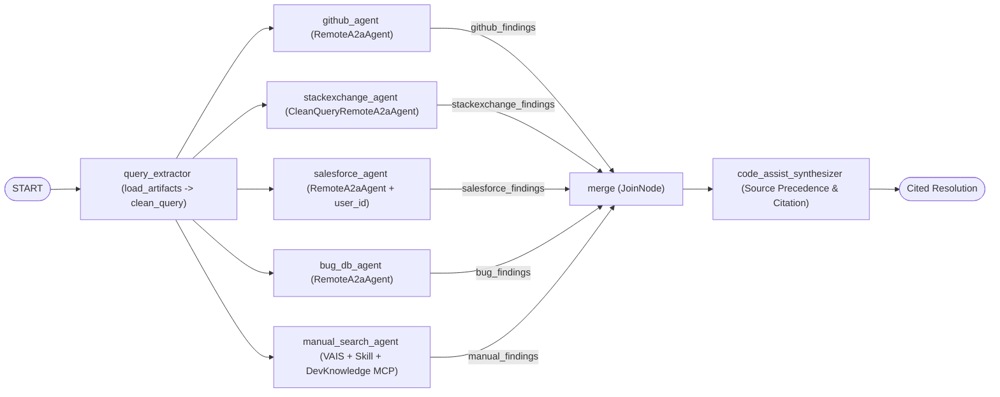

# FDE: Build Enterprise Agents — Multi-Runtime Code Assist System

An enterprise-grade, multi-agent **Production Incident & Code Resolution Platform ("Code Assist")** built on **Google Cloud** using **ADK (Agent Development Kit) 2.0**, **LangGraph**, the **Agent2Agent (A2A) Protocol**, **Model Context Protocol (MCP)**, **GCP Skill Registry**, **Vertex AI Search**, **BigQuery Vector Search**, **Vertex AI Memory Bank**, and **Gemini Enterprise**.

> **Full Step-by-Step Lab Guide:** See [**`LAB_RUNBOOK.md`**](./LAB_RUNBOOK.md) for the complete end-to-end implementation runbook, architectural blueprints, workflow diagrams, CLI commands, IAM configurations, and production troubleshooting matrix.

---

## 1. System Architecture

`code-assistant` acts as an ADK 2.0 `Workflow` graph orchestrator deployed on **Vertex AI Agent Runtime** and surfaced through **Gemini Enterprise**. When an engineer reports a production incident or uploads a stack trace, the orchestrator distills a clean search query and fans out **in parallel** across five heterogeneous knowledge domains spanning **Agent Runtime**, **Cloud Run**, **GKE Autopilot**, **Vertex AI Search**, and **MCP servers**, then synthesizes a single source-attributed fix.

```mermaid
flowchart TB
    subgraph Client["Enterprise Experience Layer"]
        User(["Engineer / SRE"])
        GE["Gemini Enterprise App (Code Assist)"]
    end

    subgraph Orchestrator["Vertex AI Agent Runtime (Root Orchestrator)"]
        direction TB
        QE["1. query_extractor (Gemini 3.5 Flash + load_artifacts)"]
        MS["2e. manual_search_agent (In-Process ADK Agent)"]
        JOIN["3. merge (ADK 2.0 JoinNode)"]
        SYNTH["4. code_assist_synthesizer (Source-Attributed Fix)"]
    end

    subgraph GoogleManaged["Google Cloud Knowledge & Tooling"]
        VAIS[("Vertex AI Search (code-manuals-datastore)")]
        SKILLS["GCP Skill Registry (using-developer-knowledge-mcp)"]
        DKMCP["Developer Knowledge MCP (developerknowledge.googleapis.com)"]
    end

    subgraph RemoteSpecialists["Distributed Specialist Fleet (A2A Protocol)"]
        direction LR
        GH["2a. github-agent (ADK on Agent Runtime)"]
        SE["2b. stackexchange-agent (LangGraph on Cloud Run / GKE)"]
        BQ["2c. bq-agent (ADK on GKE Autopilot)"]
        SF["2d. salesforce-agent (ADK on Cloud Run)"]
    end

    subgraph Backends["Enterprise & External Data Systems"]
        direction LR
        GHMCP["GitHub Copilot MCP Server (Repos / Issues / PRs)"]
        SEAPI["Stack Exchange API (Community Q&A)"]
        BQDB[("BigQuery Vector Search (code_assist_bugs.known_bugs)")]
        SFAPI["Salesforce Files SOSL API (Org ADRs & Policies)"]
        MEM[("Vertex AI Memory Bank (User-Scoped Long-Term Memory)")]
    end

    User -->|"Stack trace / Error + File"| GE
    GE -->|"Authenticated ADK Stream + End-User ID"| QE

    QE -->|"clean_query (A2A + ADC Bearer)"| GH
    QE -->|"clean_query (A2A v0.3/v1.0 Compat)"| SE
    QE -->|"clean_query (A2A over External LB)"| BQ
    QE -->|"clean_query + metadata.user_id (A2A)"| SF
    QE -->|"clean_query (Shared Session State)"| MS

    MS -->|"Grounded Handbook Lookup"| VAIS
    MS -->|"On-Demand Skill Discovery"| SKILLS
    MS -->|"Official Google Docs Search"| DKMCP

    GH -->|"PAT Bearer (Read-Only Filter)"| GHMCP
    SE -->|"StackExchangeTool"| SEAPI
    BQ -->|"Workload Identity + text-embedding-004"| BQDB
    SF -->|"2-Legged OAuth (client_credentials)"| SFAPI
    SF <-->|"PreloadMemoryTool + add_session_to_memory"| MEM

    GH -->|"github_findings"| JOIN
    SE -->|"stackexchange_findings"| JOIN
    BQ -->|"bug_findings"| JOIN
    SF -->|"salesforce_findings"| JOIN
    MS -->|"manual_findings"| JOIN

    JOIN --> SYNTH
    SYNTH -->|"Cited Resolution (Internal Priority > Community)"| GE
    GE --> User
```



---

## 2. Multi-Agent Fleet Matrix

| Agent | Framework | Compute Runtime | Protocol / Auth | Primary Tools & Data Sources |
| :--- | :--- | :--- | :--- | :--- |
| **`code-assistant`** *(Root)* | ADK 2.0 `Workflow` Graph | **Vertex AI Agent Runtime** | ADK Native + A2A (`is_a2a: true`), IAM (`roles/aiplatform.user`) | `RemoteA2aAgent` (x4), `VertexAiSearchTool`, `SkillToolset` (`GCPSkillRegistry`), `McpToolset` (Developer Knowledge MCP) |
| **`github-agent`** | ADK Python (`Agent`) | **Vertex AI Agent Runtime** | A2A over `/api` passthrough (ADC OAuth2 Bearer) | `McpToolset` -> Hosted GitHub MCP (`search_repositories`, `search_issues`, `list_issues`) |
| **`stackexchange-agent`** | **LangGraph** (`StateGraph`) | **Cloud Run** *(or GKE Autopilot)* | A2A `a2a-sdk` 1.x with `v0.3` compatibility | LangChain `StackExchangeTool` (stateless, zero-LLM retrieval node) |
| **`bq-agent`** | ADK Python (`Agent`) | **GKE Autopilot** (Terraform + External LB) | A2A JSON-RPC + GKE Workload Identity (`bq-agent-app` SA) | `find_similar_bugs` -> `text-embedding-004` (`768`-dim) + BigQuery `VECTOR_SEARCH` (`COSINE`, `top_k=3`) |
| **`salesforce-agent`** | ADK Python (`Agent`) | **Cloud Run** | A2A with forwarded `metadata.user_id` | `search_salesforce` (2LO OAuth + SOSL + `.docx`/`.pdf` excerpting) + **Vertex AI Memory Bank** |

---

## 3. Execution & Orchestration Workflow



### Source Precedence Policy
When specialist findings conflict, `code_assist_synthesizer` enforces strict enterprise governance:
1. **Tier 1 — Authoritative Internal Sources:** Internal Bug Database (`bq-agent`), Team Engineering Handbook (`Vertex AI Search`), and Org-Wide ADRs / Policies (`salesforce-agent`).
2. **Tier 2 — Official Vendor Documentation:** Google Official Developer Docs (`Developer Knowledge MCP`, guided by `using-developer-knowledge-mcp` from `GCPSkillRegistry`).
3. **Tier 3 — Public Community Sources:** GitHub Issues/PRs (`github-agent`) and Stack Exchange Q&A (`stackexchange-agent`).

---

## 4. Repository Structure

```text
FDE-Build-Enterprise-Agents/
├── README.md                          # Architecture overview, fleet matrix & quickstart
├── LAB_RUNBOOK.md                     # Complete Step-by-Step Lab Runbook (Tasks 1–8)
└── agents/
    ├── .agents-cli-spec.md            # Formal specification for bq-agent
    ├── code-assistant/                # Root ADK 2.0 Graph Workflow Orchestrator
    │   ├── app/
    │   │   ├── agent.py               # Fan-out / JoinNode / Synthesizer Workflow
    │   │   ├── auth.py                # ADC OAuth2 httpx client & MCP headers
    │   │   ├── callbacks.py           # State capture callbacks for RemoteA2aAgent
    │   │   ├── skills/                # using-developer-knowledge-mcp SKILL.md
    │   │   └── app_utils/             # A2A routes, user_id_meta_provider, clean_query
    │   └── scripts/publish_skill.py   # Idempotent GCP Skill Registry publisher
    ├── github-agent/                  # GitHub MCP Specialist (Vertex AI Agent Runtime)
    ├── stackexchange-agent/           # LangGraph Specialist (Cloud Run / GKE Autopilot)
    ├── bq-agent/                      # BigQuery Vector Search Specialist (GKE Autopilot)
    │   ├── app/tools.py               # text-embedding-004 + parameterized VECTOR_SEARCH
    │   └── deployment/terraform/      # VPC, Cloud NAT, GKE Autopilot, Workload Identity, LB
    └── salesforce-agent/              # Salesforce SOSL + Vertex AI Memory Bank Specialist
        ├── app/salesforce_client.py   # 2-Legged OAuth + SOSL + .docx/.pdf text extraction
        └── scripts/create_memory_bank.py # Idempotent Memory Bank provisioning
```

---

## 5. Quick Start

Follow [**`LAB_RUNBOOK.md`**](./LAB_RUNBOOK.md) sequentially:

1. **Task 1:** Bootstrap GCP environment, `google-agents-cli`, Terraform, and Vertex AI Search (`code-manuals-datastore`).
2. **Task 2:** Implement `McpToolset` in `github-agent` and deploy to **Vertex AI Agent Runtime**.
3. **Task 3:** Compile the `LangGraph` workflow in `stackexchange-agent` and deploy to **Cloud Run**.
4. **Task 4:** Build, unit-test, evaluate (`agents-cli eval run`), and deploy `bq-agent` to **GKE Autopilot**.
5. **Task 5:** Publish `using-developer-knowledge-mcp` to **GCP Skill Registry**, wire specialist URLs + `user_id_meta_provider`, configure IAM, and deploy `code-assistant` to **Agent Runtime**.
6. **Task 6:** Register `code-assistant` in **Gemini Enterprise** (`agents-cli publish gemini-enterprise`).
7. **Task 7:** Configure Salesforce 2LO + Files corpus, provision **Vertex AI Memory Bank**, wire `PreloadMemoryTool` & user-scoped A2A metadata in `salesforce-agent`, deploy to **Cloud Run**, and update `code-assistant`.
8. **Task 8:** Run end-to-end multi-source validation and review observability traces.
